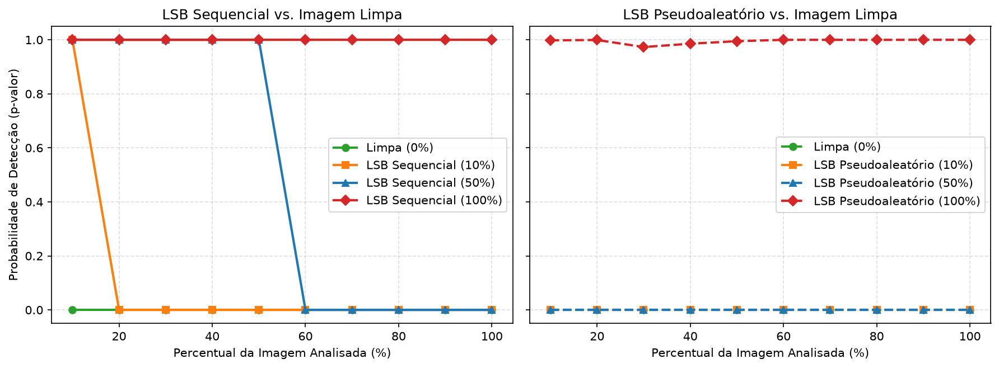

# Projeto 3 — Esteganálise Estatística Espacial: Teste do Qui-Quadrado ($\chi^2$)

## 1. Questões Teóricas

### a) Pares de Valores (PoVs) e efeito do payload LSB
Na inserção LSB simples, apenas o último bit do pixel é trocado por $0$ ou $1$. Com isso, um pixel de valor par $2k$ só pode virar $2k+1$, e um pixel ímpar $2k+1$ só pode virar $2k$. Eles nunca saem desse par $\{2k, 2k+1\}$, chamado de **Par de Valores (PoV)**.

- Em uma **imagem limpa**, as frequências de $2k$ e $2k+1$ no histograma são naturalmente diferentes ($h_{2k} \neq h_{2k+1}$).
- À medida que a **taxa de payload aumenta**, como os bits ocultos têm distribuição uniforme ($50\%$ de zeros e $50\%$ de uns), as contagens de $2k$ e $2k+1$ vão se igualando até atingirem a média do par:
  $$h_{2k} \approx h_{2k+1} \approx \frac{h_{2k} + h_{2k+1}}{2}$$

### b) Formulação do Teste do Qui-Quadrado ($\chi^2$) e Hipótese Nula ($H_0$)
- **Hipótese Nula ($H_0$):** A amostra contém mensagem oculta via LSB (ou seja, os valores dentro de cada par $(2k, 2k+1)$ têm frequências iguais).
- Para cada um dos 128 pares ($k = 0 \dots 127$), observa-se $X_k = h_{2k}$ e calcula-se a frequência esperada $Z_k = \frac{h_{2k} + h_{2k+1}}{2}$.
- A estatística do teste é:
  $$\chi^2 = \sum_{k} \frac{(X_k - Z_k)^2}{Z_k}$$
- A partir de $\chi^2$ e dos graus de liberdade ($\nu = K_{\text{ativos}} - 1$), calcula-se o **$p$-valor** (probabilidade de infecção):
  - **$p \approx 1$:** frequências $2k$ e $2k+1$ muito parecidas $\rightarrow$ **presença de esteganografia**.
  - **$p \approx 0$:** frequências $2k$ e $2k+1$ diferentes $\rightarrow$ **imagem limpa**.

### c) Por que funciona no LSB Sequencial, mas falha no LSB Pseudoaleatório ou payload baixo?
- **LSB Sequencial:** Os bits ocultos ficam concentrados todos no começo da imagem ($100\%$ de ocupação nos primeiros $X\%$ dos pixels). Quando o algoritmo analisa apenas os primeiros $10\%, 20\%, \dots$ da imagem, aquela região está $100\%$ modificada, gerando $p \approx 1$ até o ponto onde a mensagem acaba.
- **LSB Pseudoaleatório:** Os bits são espalhados pela imagem inteira. Qualquer pedaço analisado ($10\%, 20\%, \dots, 100\%$) terá uma mistura de pixels alterados com muitos pixels originais intactos. Os pixels intactos mantêm a diferença entre $2k$ e $2k+1$ alta, fazendo o $\chi^2$ continuar alto e o $p$-valor dar $0$ (falso negativo) em taxas baixas ou médias ($10\%$ e $50\%$).

### d) Ataque Genérico (Universal/Blind) vs. Ataque Específico (Targeted)
- **Ataque Específico (*Targeted*):** Feito sob medida para explorar a falha de um algoritmo conhecido (ex.: o teste $\chi^2$ feito especificamente para detectar igualação de PoVs no LSB simples).
- **Ataque Genérico (*Universal/Blind*):** Não sabe qual algoritmo foi usado; extrai diversas características estatísticas da imagem e usa aprendizado de máquina/classificadores para separar imagens naturais limpas de imagens alteradas.

---

## 2. Estrutura do Código

O projeto foi modularizado em 4 arquivos diretos:
- [lsb.py](file:///home/xavier/Documentos/ocultacao/lsb.py): Funções `inserir_lsb_sequencial` e `inserir_lsb_pseudoaleatorio`.
- [chi_square.py](file:///home/xavier/Documentos/ocultacao/chi_square.py): Cálculo dos PoVs (`calcular_povs`), teste estatístico (`teste_chi_quadrado`) e varredura de $10\%$ a $100\%$ (`varredura_cumulativa`).
- [experimento.py](file:///home/xavier/Documentos/ocultacao/experimento.py): Geração da bateria de testes e plotagem dos gráficos.
- [main.py](file:///home/xavier/Documentos/ocultacao/main.py): Função `main()` que executa o experimento (com a imagem padrão ou passando o caminho de uma imagem) e gera a tabela e o gráfico.

### Como Executar

```bash
# Rodar com a imagem de teste padrão:
.venv/bin/python3 main.py

# Ou passar o caminho de uma imagem própria:
.venv/bin/python3 main.py imagens/clean.png
```

---

## 3. Resultados do Experimento



### Tabela de Probabilidade de Detecção ($p$-valor) ao longo da imagem

| Cenário | 10% | 20% | 30% | 40% | 50% | 60% | 70% | 80% | 90% | 100% |
| :--- | :---: | :---: | :---: | :---: | :---: | :---: | :---: | :---: | :---: | :---: |
| **Limpa (0%)** | 0.0000 | 0.0000 | 0.0000 | 0.0000 | 0.0000 | 0.0000 | 0.0000 | 0.0000 | 0.0000 | 0.0000 |
| **LSB Sequencial (10%)** | **1.0000** | 0.0000 | 0.0000 | 0.0000 | 0.0000 | 0.0000 | 0.0000 | 0.0000 | 0.0000 | 0.0000 |
| **LSB Sequencial (50%)** | **1.0000** | **1.0000** | **0.9999** | **1.0000** | **0.9999** | 0.0000 | 0.0000 | 0.0000 | 0.0000 | 0.0000 |
| **LSB Sequencial (100%)** | **1.0000** | **1.0000** | **1.0000** | **1.0000** | **1.0000** | **1.0000** | **1.0000** | **1.0000** | **1.0000** | **1.0000** |
| **LSB Pseudoaleatório (10%)** | 0.0000 | 0.0000 | 0.0000 | 0.0000 | 0.0000 | 0.0000 | 0.0000 | 0.0000 | 0.0000 | 0.0000 |
| **LSB Pseudoaleatório (50%)** | 0.0000 | 0.0000 | 0.0000 | 0.0000 | 0.0000 | 0.0000 | 0.0000 | 0.0000 | 0.0000 | 0.0000 |
| **LSB Pseudoaleatório (100%)** | **0.9980** | **0.9993** | **0.9732** | **0.9855** | **0.9948** | **0.9998** | **0.9998** | **0.9997** | **1.0000** | **0.9999** |

### Avaliação de Eficácia e Falsos Positivos
- **LSB Sequencial:** O detector acertou todos os casos ($10\%$, $50\%$ e $100\%$), mostrando $p \approx 1$ exatamente até o percentual onde a mensagem termina e caindo para $0$ logo depois.
- **LSB Pseudoaleatório:** Em $10\%$ e $50\%$, o teste deu $p = 0$ em toda a varredura (não detectou), funcionando apenas quando $100\%$ dos pixels foram alterados.
- **Falsos Positivos:** Em imagens naturais limpas a taxa de falso positivo é próxima de zero ($p = 0$). Falsos positivos ocorrem apenas se a imagem limpa tiver muito ruído aleatório ou gradientes sintéticos suaves onde os pares $(2k, 2k+1)$ já tenham quantidades quase iguais por acaso.
